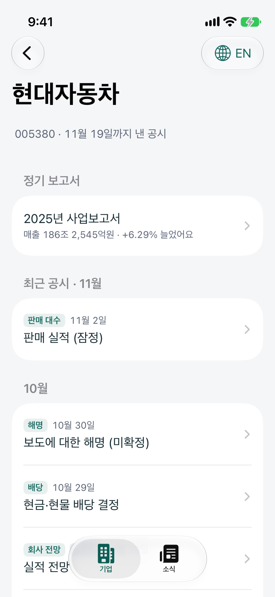
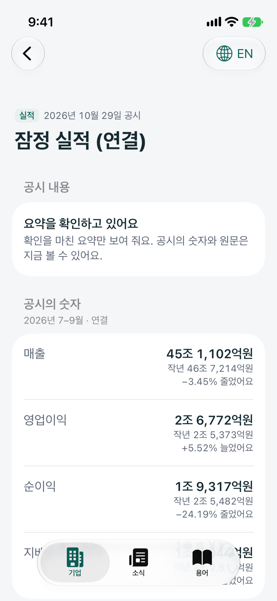
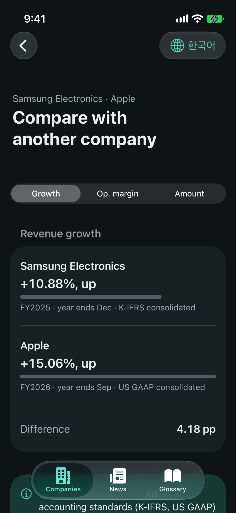
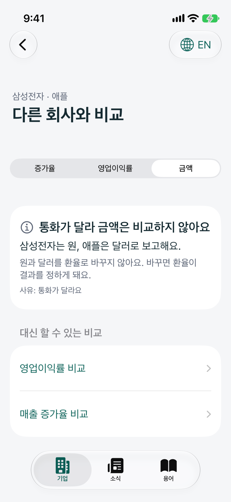
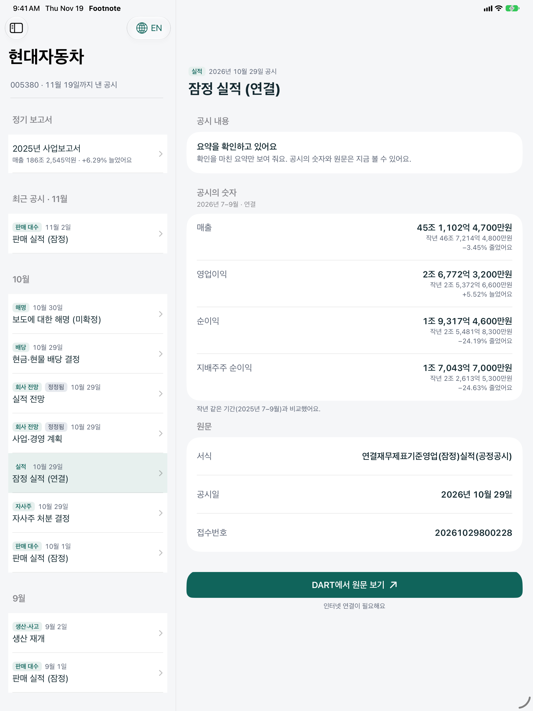

# Filing Footnote

Footnote is an app for iPhone, iPad and Mac that explains what 18 well-known Korean and US companies officially filed: their latest annual report and up to ten recent event filings each, such as results, dividends, buybacks and company outlooks. Each filing gets a short, neutral summary attributed to the company, the figures it states, and a link to the original on DART or SEC. Figures are exact decimals taken from the regulator's structured data, comparisons show their calculation, and the app says plainly when a comparison would mislead. It runs offline from a bundled, read-only data file and gives no advice.

Footnote는 한국과 미국의 잘 알려진 기업 18곳이 공식 제출한 공시를 쉬운 말로 풀어 주는 iPhone, iPad, Mac 앱입니다. 기업마다 최신 사업보고서와 최근 이벤트 공시(실적, 배당, 자사주, 회사 전망 등)를 최대 열 건까지 보여 줍니다. 공시마다 회사의 말로 표시한 중립적인 짧은 요약, 공시에 적힌 숫자, DART 또는 SEC 원문 링크가 붙습니다. 숫자는 규제 기관의 정형 데이터에서 가져온 정확한 소수이고, 비교에는 계산 과정이 함께 나오며, 오해를 줄 수 있는 비교는 하지 않는다고 분명히 알려 줍니다. 앱에 들어 있는 읽기 전용 데이터 파일로 오프라인에서 동작하고, 투자 조언은 하지 않습니다.

## Status

Filing Footnote v0.1 is in development. Nothing is released.

- The app, the data pipeline and the release gates are built and tested.
- Summaries are awaiting owner approval. The summary build stages them; none is approved yet, and only approved summaries can ship. Until then every filing page shows its figures and a "summary in review" note, as in the screenshots below.
- The glossary wording is drafted and awaiting the same approval.
- The release data bundle is not built yet. A release build refuses a development bundle, so it waits for the approvals.
- The walkthrough video is not recorded yet.

Walkthrough: **[placeholder: walkthrough link, added once it is recorded]**

## Screenshots

Taken on the iPhone and iPad simulators from a development bundle (real filings, summaries not yet approved).

| Company page | Filing page | Compare two companies |
|---|---|---|
|  |  |  |

| Refused comparison | iPad split view |
|---|---|
|  |  |

More in [docs/screenshots/footnote/](docs/screenshots/footnote/).

## How the data is made

Everything below runs on the owner's Mac before a build. The app itself makes no network call to show a filing; only "open the original" needs one.

1. Ingest from DART and SEC. `python -m app.ingest` fetches each company's annual reports, financial statements and twelve months of event filings into a local PostgreSQL build database. Each filing gets one category from a fixed list by deterministic rules ([ADR 0004](docs/adr/0004-event-filings-in-scope.md), [ADR 0007](docs/adr/0007-notices-and-wider-event-scope.md)).
2. Pin the source files. With `--save-pinned`, ingest saves the regulator's raw responses. The export later re-reads every figure and fact from these files with the same parser and fails on any difference.
3. Guards. Generated text may contain no digits, because figures are shown from structured data; no hype or judgement words, predictions or advice; and every statement is attributed to the company ([ADR 0005](docs/adr/0005-neutrality-guards.md), word lists in [contracts/neutrality-lexicon.json](contracts/neutrality-lexicon.json)). Figures are `Decimal` end to end and stored as canonical decimal strings ([ADR 0006](docs/adr/0006-bundled-sqlite-with-exact-decimals.md)).
4. Summaries on Groq's free tier. `python -m app.build.summaries generate` writes Korean and English lines with Groq's `qwen/qwen3.8-27b` and runs the guard on them. A failing summary is retried once, then withheld. DART filings that are plain tables (preliminary results, unit sales, dividends, outlooks) get fixed template lines instead of a model call.
5. Owner approval. `python -m app.build.review` writes a proofreading page, and `python -m app.build.approve` moves the summaries the owner approves into `backend/data/summaries/approved.jsonl`. Agents and the model reviewer never approve.
6. The `footnote.sqlite` bundle. `python -m app.build.export` (or `make data`) writes the read-only SQLite file and a build report. A release export refuses unapproved summaries or glossary entries, stale approvals and any figure that does not match its pinned source. `python -m app.build.verify --release` re-checks a finished file on its own.
7. The SwiftUI app. One app target for iPhone, iPad and native Mac reads the bundle through the FootnoteKit package, offline and read-only ([ADR 0008](docs/adr/0008-native-multiplatform-app.md)).

[docs/ARCHITECTURE.md](docs/ARCHITECTURE.md) has the modules and the bundle contract; [docs/DEVELOPMENT.md](docs/DEVELOPMENT.md) has the commands.

## Run the checks

Requires Python 3.11. On macOS it also needs Xcode for `swift test`; on other systems the FootnoteKit tests are skipped. XcodeGen 2.46.0 is optional; without it the project check is skipped.

```bash
python3.11 -m venv .venv
.venv/bin/pip install -r backend/requirements.lock ruff==0.15.21
scripts/check.sh
```

The last line must be `GATE: PASS`. `scripts/check.sh` runs Ruff, the offline backend tests, the FootnoteKit tests (`swift test`), a check that `ios/Footnote.xcodeproj` matches `ios/project.yml`, and a check that no app code converts currencies. It needs no database, no API keys and no network; the embedding model is never loaded.

## Run the app and its tests

The Xcode project is generated from `ios/project.yml` with XcodeGen 2.46.0 and committed, so a fresh checkout opens in Xcode as is. After editing `ios/project.yml`:

```bash
brew install xcodegen   # check.sh expects version 2.46.0
xcodegen generate --spec ios/project.yml
```

Unit tests, on an iOS simulator or on the Mac:

```bash
xcodebuild test -project ios/Footnote.xcodeproj -scheme Footnote \
  -destination 'platform=iOS Simulator,id=<UDID>' CODE_SIGNING_ALLOWED=NO
xcodebuild test -project ios/Footnote.xcodeproj -scheme Footnote \
  -destination 'platform=macOS' CODE_SIGNING_ALLOWED=NO
```

UI tests (iOS only):

```bash
xcodebuild test -project ios/Footnote.xcodeproj -scheme FootnoteUITests \
  -destination 'platform=iOS Simulator,id=<UDID>' CODE_SIGNING_ALLOWED=NO
```

Without a data bundle at `ios/Footnote/Resources/footnote.sqlite` (git-ignored), a debug build uses the small FootnoteKit test fixture, so the app runs from a clean checkout. A release build needs a release bundle.

## Documentation

| Document | Contents |
|---|---|
| [PRODUCT.md](PRODUCT.md) | What the product is, who it is for, and its rules |
| [docs/ARCHITECTURE.md](docs/ARCHITECTURE.md) | Modules, data flow, bundle contract, release gates |
| [docs/DEVELOPMENT.md](docs/DEVELOPMENT.md) | Setup, data build, tests |
| [docs/CASE_STUDY.md](docs/CASE_STUDY.md) | Problem, constraints, decisions and what went wrong |
| [docs/design/DESIGN.md](docs/design/DESIGN.md) | Visual system and screens |
| [docs/DECISIONS.md](docs/DECISIONS.md) and [docs/adr/](docs/adr/) | Decision ledger and architecture decisions |
| [CHANGELOG.md](CHANGELOG.md) | Changes |

History: Footnote grew out of two earlier projects by the same owner, Filing Digest and Filing Agent; DECISIONS.md entries before D59, ADRs 0001 to 0003 and [docs/history/](docs/history/) describe Filing Digest.

## License

Copyright (c) 2026 Michael Ju. All rights reserved.
No license is granted for use, copying, modification, or distribution of this code as of 2026-07-30. This repository is public for portfolio review purposes only.
