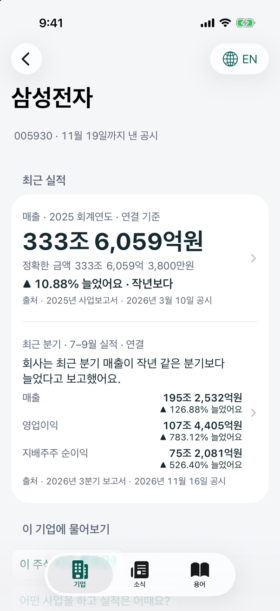
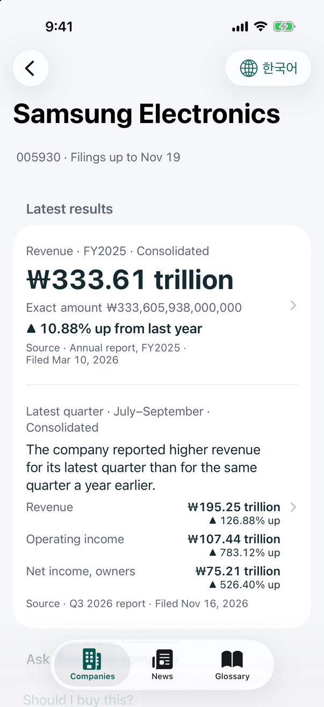
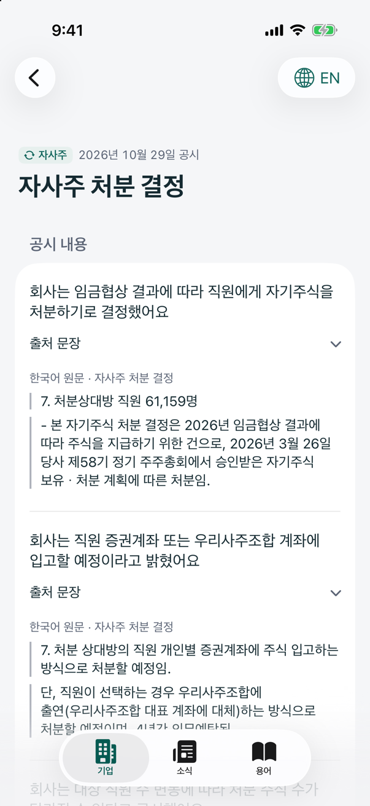
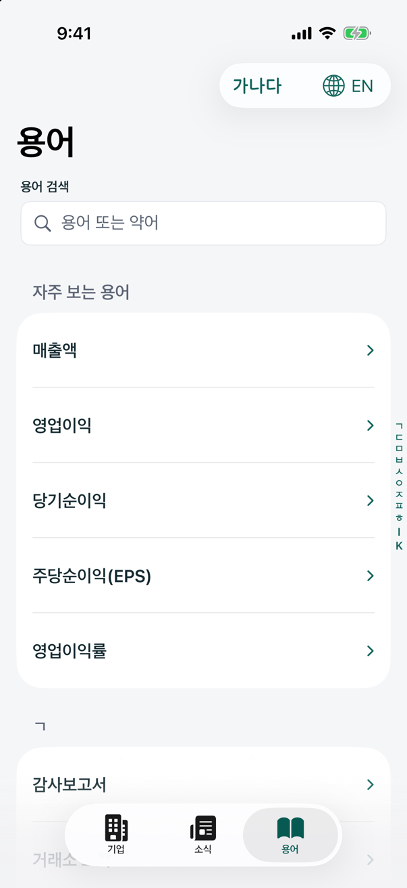
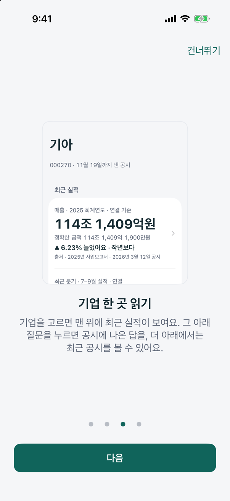
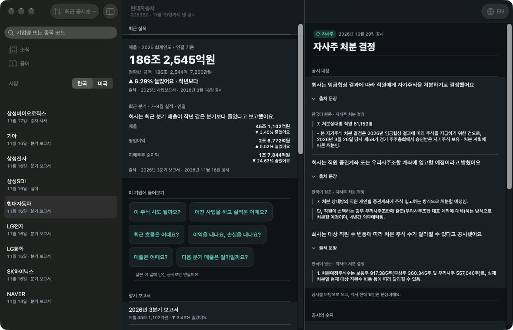

# Filing Footnote

Footnote is an iPhone, iPad and Mac app that explains, in plain Korean and English, what 18 Korean and US companies have filed with their regulators, DART in Korea and the SEC in the US. For each company it covers the latest annual report and up to ten recent event filings: results, dividends, buybacks, executive changes, company outlooks and similar. Each filing gets a three-line summary attributed to the company, the figures it states, and a link to the original.

Every summary line can be traced to the sentence in the filing it was written from. Figures are exact decimals taken from the regulator's structured data, not from model output. The app runs offline from a bundled read-only database. It gives no investment advice and makes no predictions. Asked "Should I buy this?", it says it does not tell anyone to buy or sell, and offers the fundamentals, profit and trend questions instead.

**Status:** v0.5.2 is the version number the backend and app still carry from the predecessor project; it changes with Footnote's first release. The release data bundle is not built yet, because some filings still lack an owner-approved summary (see [Current numbers](#current-numbers)).

## Screenshots

From the iPhone 17 simulator (iOS 26.5) and the Mac app, on 2026-11-26. The data is a preview bundle: real filings, and only summaries the owner approved.

<table>
<tr>
<td width="33%"></td>
<td width="33%"></td>
<td width="33%"></td>
</tr>
<tr>
<td>Company page, Korean</td>
<td>Company page, English</td>
<td>Filing page with each line's source sentence open</td>
</tr>
<tr>
<td></td>
<td></td>
<td></td>
</tr>
<tr>
<td>Glossary</td>
<td>First-run guide, page 3 of 4</td>
<td></td>
</tr>
</table>



Older screens (2026-11-20, development bundle) are in [docs/screenshots/footnote/](docs/screenshots/footnote/). A [walkthrough video](https://github.com/mhju0/filing-footnote/releases/tag/walkthrough-2026-11-20) (2 min 23 s) was recorded on 2026-11-20, before the summary card, source sentences and first-run guide were added.

## Architecture

```
DART / SEC APIs
  └─ ingest ─────────────── PostgreSQL build database + pinned raw responses
       └─ summaries ─────── Groq (free tier) or a fixed template, then the neutrality guard
            └─ faithfulness ─ each line aligned to its source sentences
                 └─ review + approve ── the owner reads and approves every summary
                      └─ export + verify ── footnote.sqlite (read-only, exact decimals)
                           └─ FootnoteKit ── SwiftUI app on iPhone, iPad and Mac
```

Everything above the app runs on the owner's Mac before a build. The app makes no network call to show a filing; only "open the original" goes online.

- **Ingest** (`backend/app/ingest`, `backend/app/clients`). Fetches annual reports, financial statements and twelve months of event filings from DART and SEC EDGAR. Each filing gets one category from fixed rules, not from a model ([ADR 0004](docs/adr/0004-event-filings-in-scope.md), [ADR 0007](docs/adr/0007-notices-and-wider-event-scope.md)). With `--save-pinned` it keeps the regulator's raw responses, and the export later re-parses every figure from them and fails on any difference.
- **Summaries** (`backend/app/build/summaries.py`). One model call writes the Korean and English lines together. Filings that are tables (preliminary results, dividends, unit sales, outlooks) get template lines with the table's values and no model call (D78).
- **Owner approval** (`app.build.review`, `app.build.approve`). The review page shows each line with its faithfulness verdict and source sentence, flagged summaries first. Only rows the owner approves move to the tracked `backend/data/summaries/approved.jsonl`. Agents and the model reviewer never approve.
- **Bundle** (`app.build.export`, `app.build.verify`). A STRICT SQLite file, schema 5, with figures stored as canonical decimal strings ([ADR 0006](docs/adr/0006-bundled-sqlite-with-exact-decimals.md)) and a `summary_sources` table holding each line's source sentences (D101). A release export refuses unapproved or stale summaries, unapproved glossary wording, figures that differ from the pinned source, and lines that fail the faithfulness gate. A release build of the app refuses a development bundle.
- **App** (`ios/`). One SwiftUI target for iPhone, iPad and native Mac, not Catalyst ([ADR 0008](docs/adr/0008-native-multiplatform-app.md)). The FootnoteKit Swift package reads the bundle and holds the models, formatting and comparison calculator, so it is tested with `swift test` without a simulator. The comparison rules are a shared contract: Python and Swift both pass the same 112 cases in `contracts/comparison-cases.json`. Cross-company comparisons use growth rates and margins only, and the gate fails if app code converts a currency (D84).
- **Ask about this company** (D99). Six fixed questions on the company page, answered by FootnoteKit from the bundle with fixed sentences and exact figures. Nothing is generated on the device.

[docs/ARCHITECTURE.md](docs/ARCHITECTURE.md) has the modules and the bundle contract.

## How the model is used

Generation runs on Groq's free tier with `qwen/qwen3.8-27b` (D68), and summaries stay on the free tier (D88). The free tier set several limits in the code: at most 768 output tokens per summary call, DART source text cut at 7,000 characters to stay under the per-minute input limit (D69), a wait between calls, and one retry after an HTTP 429. Output that never becomes valid JSON skips the section instead of stopping the run (D71).

Each generated line then goes through three checks.

1. **Neutrality guard** (`backend/app/llm/neutrality_guard.py`, word lists in [contracts/neutrality-lexicon.json](contracts/neutrality-lexicon.json)). Rules N1 to N8: no digits (figures come from structured data), no evaluative words, no prediction beyond the filing, attribution to the company, an official source link, line count and length, no advice, and the right language. A failing summary is retried once with the violations listed, then withheld. N9 flags soft intensity words as a warning only ([ADR 0005](docs/adr/0005-neutrality-guards.md)).
2. **Model reviewer**. One advisory call per summary that passed the guard. It stores flags for the owner and never approves or blocks.
3. **Faithfulness aligner** (`backend/app/build/faithfulness.py`, D97, D102, D103). The guard checks how a line is written, not whether the filing says it. In a pilot, a line replaced the region named in a filing with a different place, and neither the guard nor the reviewer caught it. The aligner is deterministic and makes no model call. It cuts the source text into sentences, matches Korean words by stem and English words by prefix, treats places, products, currencies, numbers and acronyms as strict entities ([contracts/faithfulness-lexicon.json](contracts/faithfulness-lexicon.json)), and scores each line against its best span of up to two sentences. Overlap from 0.7 is `supported`, from 0.4 `partly`, below that `unsupported`. A strict entity the source never names, or a rival action (acquire instead of dispose, appoint instead of resign), makes a line `unsupported`.

**Release gate.** `verify --release` blocks any `unsupported` line by default, unless the owner has read it and recorded an override that is bound to the line's hash, so an edit voids it. `partly` lines show on the review page but do not block. Over the approved summaries the gate counts 0 unsupported lines; the owner accepted 2 (line 3 of one SEC filing, Korean and English, a faithful paraphrase of a list of note tranches) (D100, D105).

**Eval.** `make faithfulness-eval` scores the aligner on 73 labelled lines from 22 cases in both languages: real approved lines and synthetic edits of them (a swapped region, product, action, number or negation). The labels were written by the coding agent and have not been reviewed by the owner.

| Aligner `f3-2026-11-26` | Precision | Recall |
|---|---|---|
| `unsupported`, all 73 lines | 14 / 14 | 14 / 24 |
| `unsupported`, held-out test split (39 lines) | 4 / 4 | 4 / 9 |
| `partly` or `unsupported`, all 73 lines | 20 / 26 | 20 / 28 |

It has not falsely blocked a faithful line, and it misses many unfaithful ones. It misses a changed word that the same filing uses elsewhere, a name the lexicon does not hold, and a Korean-only edit whose English twin is faithful. A flipped negation lands on `partly`, which does not block. The test split's real lines come from rows the lexicon was tuned on, so only its synthetic edits are unseen. This is why a person still approves every summary.

## Accessibility

- **VoiceOver and Apple's audit.** `AccessibilityAuditUITests` runs `performAccessibilityAudit` on 28 screens in Korean and English, at the default text size, at Accessibility XL and in dark mode: six configurations, each checking contrast, element detection, hit regions, element descriptions, Dynamic Type, clipped text and traits. Long screens are audited again after each swipe. Source sentences are tagged with the filing's language so VoiceOver reads them in that voice, and ▲ and ▼ are read as "increased" and "decreased".
- **Dynamic Type.** All 28 audited screens are also checked at Accessibility XL. Figures never break inside a number, and a word wider than the line shrinks instead of breaking (D87, D98).
- **Korean line breaks.** SwiftUI has no `word-break: keep-all`, so app text goes through `Text(words:)` in `KeepAll.swift`, which puts a word joiner between the letters of each Korean word. Korean therefore wraps only between words (D80). In the first-run guide, one-letter words are also bound to the next word, so no line ends on one.
- **Reduce Motion.** The few animations (rolling digits, expanding rows) are off when Reduce Motion is on (D106).

## Run it

### The gate

Requires Python 3.11. On macOS it also runs the FootnoteKit tests with Xcode's `swift test`; XcodeGen 2.47.0 is optional.

```bash
python3.11 -m venv .venv
.venv/bin/pip install -r backend/requirements.lock ruff==0.15.21
scripts/check.sh
```

The last line must be `GATE: PASS`. It runs Ruff, the offline backend tests, the FootnoteKit tests, a check that `ios/Footnote.xcodeproj` matches `ios/project.yml`, and a check that no app code converts currencies. It needs no database, API key or network.

### The backend

Building a data bundle needs a DART API key, an SEC contact string and a Groq API key in `backend/.env` (git-ignored), plus the Compose PostgreSQL (`docker compose up -d db`, port 5433). From `backend/`:

```bash
../.venv/bin/python -m app.ingest --source dart --ticker 005930 --save-pinned data/pinned
../.venv/bin/python -m app.ingest events --source dart --ticker 005930 --save-pinned data/pinned
../.venv/bin/python -m app.build.summaries generate --as-of 2026-11-19
../.venv/bin/python -m app.build.review --out ../dist/review.html
```

Then, from the repository root, `make faithfulness AS_OF=2026-11-19` and `make data AS_OF=2026-11-19 PINNED=backend/data/pinned` (or `make data-preview` with the same arguments). [docs/DEVELOPMENT.md](docs/DEVELOPMENT.md) has every step.

### The app

The Xcode project is generated from `ios/project.yml` and committed, so a fresh checkout opens as is. Without a bundle at `ios/Footnote/Resources/footnote.sqlite` (git-ignored), a debug build uses the small FootnoteKit test fixture, so the app runs from a clean checkout.

```bash
xcodebuild test -project ios/Footnote.xcodeproj -scheme Footnote \
  -destination 'platform=iOS Simulator,id=<UDID>' CODE_SIGNING_ALLOWED=NO
xcodebuild test -project ios/Footnote.xcodeproj -scheme Footnote \
  -destination 'platform=macOS' CODE_SIGNING_ALLOWED=NO
xcodebuild test -project ios/Footnote.xcodeproj -scheme FootnoteUITests \
  -destination 'platform=iOS Simulator,id=<UDID>' CODE_SIGNING_ALLOWED=NO
```

Run the accessibility audits on a freshly booted simulator; a long run on one simulator slows later audits (D107).

## Current numbers

Measured on 2026-11-26 at commit `1797e79`.

| Number | Value | Source |
|---|---|---|
| Companies | 18 (9 DART, 9 SEC) | PRODUCT.md; `companies` table of the preview bundle |
| Event filings per company | up to 10 | `EVENT_CAP` in `backend/app/build/export.py` (D76) |
| Approved summaries | 188 Korean–English pairs over 162 filings: 158 written by the model, 30 from templates; 1,068 lines | `backend/data/summaries/approved.jsonl` |
| Unsupported lines at the release gate | 0, plus 2 the owner accepted | D105; `backend/data/summaries/faithfulness_accepted.jsonl` |
| Faithfulness eval | see the table above | `make faithfulness-eval` |
| Backend offline tests | 1,674 passed, 56 skipped | `scripts/check.sh` (`make test`) |
| FootnoteKit tests | 189 tests in 26 suites, all passed | `scripts/check.sh` (`swift test`) |
| App unit tests | 68 `@Test` functions | counted in `ios/FootnoteTests/`; last run 68/68 on iPhone and Mac in PR #64 |
| UI test methods | 40 | counted in `ios/FootnoteUITests/`; not run for this count |
| Audited screens | 28, in 6 configurations | `AccessibilityAuditUITests.swift` |
| Comparison contract cases | 112 | `contracts/comparison-cases.json` |
| Groq limits in code | 768 output tokens per call; 7,000 DART source characters | `summaries.py` `_MAX_TOKENS`; `model.py` `MAX_SOURCE_CHARS` |

The [case study](docs/CASE_STUDY.md) records the problem, the trade-offs and the failures found along the way. Its tables are dated 2026-11-20 and are kept as written.

## Documentation

| Document | Contents |
|---|---|
| [PRODUCT.md](PRODUCT.md) | What the product is, who it is for, and its rules |
| [docs/ARCHITECTURE.md](docs/ARCHITECTURE.md) | Modules, data flow, bundle contract, release gates |
| [docs/DEVELOPMENT.md](docs/DEVELOPMENT.md) | Setup, data build, tests |
| [docs/CASE_STUDY.md](docs/CASE_STUDY.md) | Constraints, decisions, failures with real filings, summary quality |
| [docs/design/DESIGN.md](docs/design/DESIGN.md) | Visual system and screens |
| [docs/DECISIONS.md](docs/DECISIONS.md) and [docs/adr/](docs/adr/) | Decision ledger (the D numbers above) and architecture decisions |
| [CHANGELOG.md](CHANGELOG.md) | Changes |

The code was written by AI coding agents (Claude Code and Codex; each commit carries an `Agent:` trailer) working to the owner's product decisions, design picks and approvals. Footnote grew out of two earlier projects by the same owner, Filing Digest and Filing Agent; DECISIONS.md entries before D59, ADRs 0001 to 0003 and [docs/history/](docs/history/) describe Filing Digest.

## License

Copyright (c) 2026 Michael Ju. All rights reserved.
No license is granted for use, copying, modification, or distribution of this code as of 2026-07-30. This repository is public for portfolio review purposes only.
